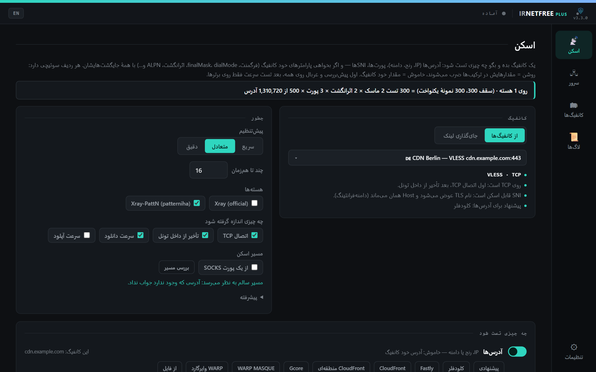
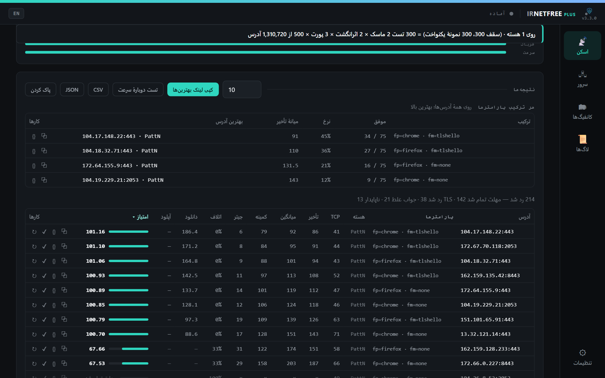
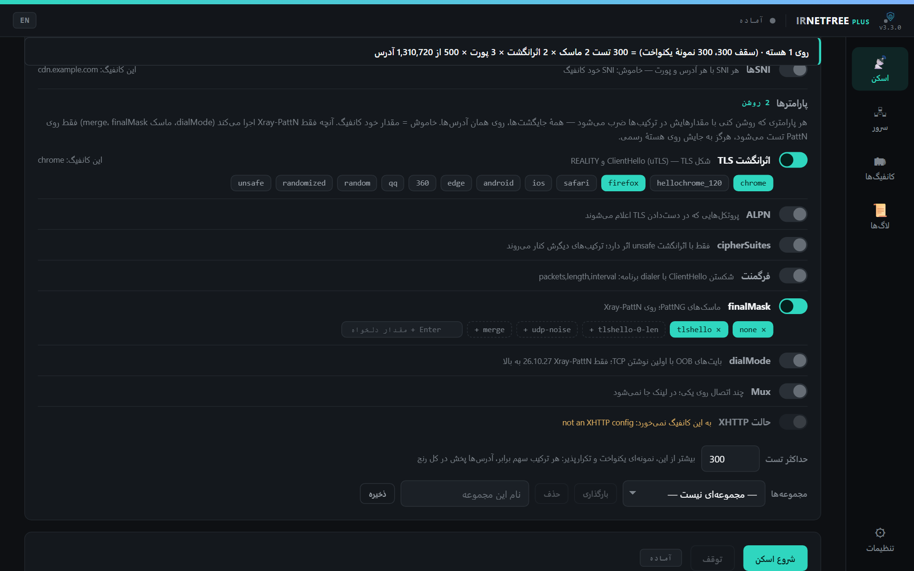
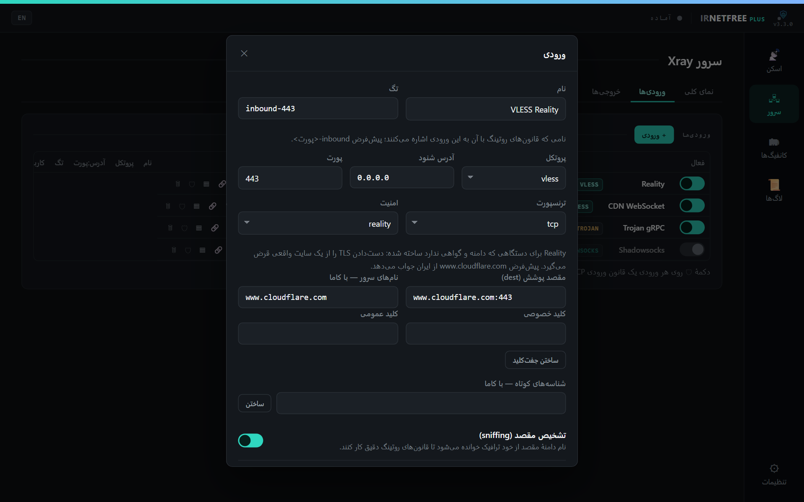
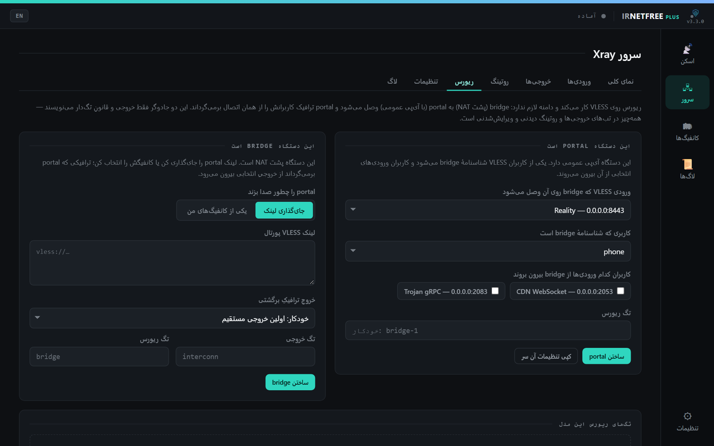
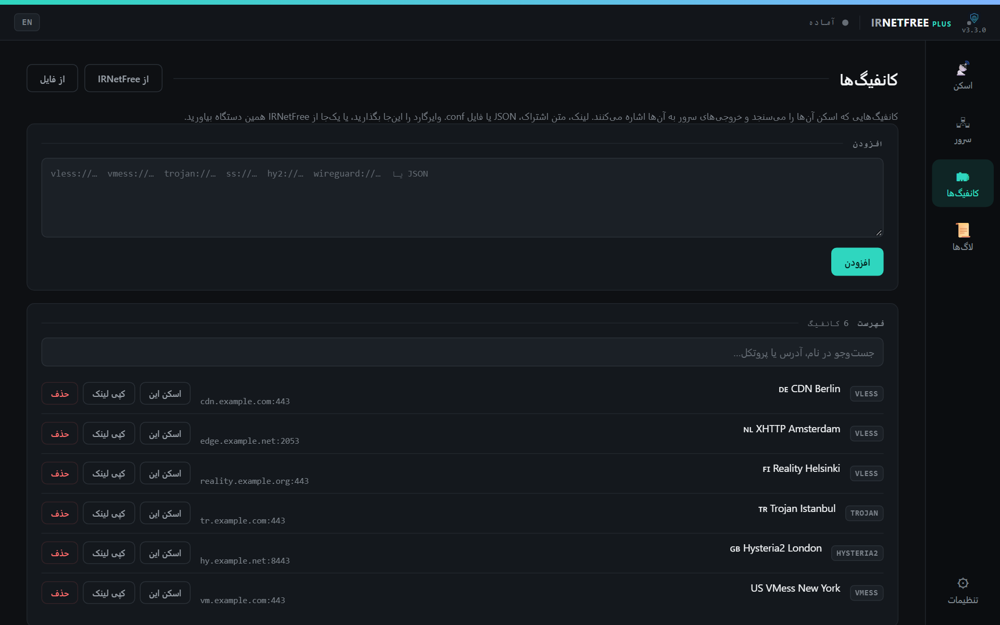
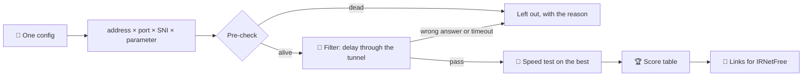

<div align="center">



<br>

[](https://github.com/sadrazkh/Irnetfree_xray-client-plus/releases/latest)
[](https://github.com/sadrazkh/Irnetfree_xray-client-plus/releases)
[](https://github.com/sadrazkh/Irnetfree_xray-client-plus/actions/workflows/test.yml)
[](https://github.com/sadrazkh/Irnetfree_xray-client-plus/stargazers)

[فارسی](README.md) · **English** · [📖 Full guide (Persian)](GUIDE.md)

### The toolbox beside IRNetFree: find clean addresses, run your own server.

[](#-download)
[](#-download)
[](#-download)
[](#-download)

</div>

## 💎 Why IRNetFree Plus?

<table>
  <tr>
    <td width="50%">🎯 <b>Any range, no cap</b><br>Cloudflare, Fastly, CloudFront and Gcore ranges are ready and update with one button. Even a /8 with 16 million addresses is walked without trouble.</td>
    <td width="50%">🧬 <b>Not only IPs, parameters too</b><br>TLS fingerprint, ALPN, fragment, finalMask, dialMode and Mux, in every permutation, on the same addresses.</td>
  </tr>
  <tr>
    <td>✅ <b>A pass means the right answer</b><br>One lucky reply or an error page does not pass. A target must give the expected answer through the tunnel, and every failed row says why.</td>
    <td>🚦 <b>It checks its own path</b><br>If a VPN answers in place of the addresses, Plus says the results are not real. You can also send the scan through a SOCKS port.</td>
  </tr>
  <tr>
    <td>🖧 <b>An Xray server, the 3x-ui way</b><br>Inbounds, clients with quotas and expiry, outbounds, routing and a reverse proxy, with no web panel or database.</td>
    <td>🤝 <b>Built to work with IRNetFree</b><br>It imports IRNetFree's configs in one click and hands the best results back as links. Both apps run side by side.</td>
  </tr>
</table>

## 📸 A look at the app

<table>
  <tr>
    <td width="50%"><br><b>📡 Scan:</b> the config, the cores, the scan path and ready ranges</td>
    <td width="50%"><br><b>🏆 Results:</b> each address's score, a summary per combination, copy the best</td>
  </tr>
  <tr>
    <td><br><b>🧬 Parameters:</b> a switch per row, with ready or custom values</td>
    <td><br><b>🖧 Server:</b> inbounds with Reality or TLS and separate clients</td>
  </tr>
  <tr>
    <td><br><b>🔁 Reverse:</b> portal and bridge wizards for a device behind NAT</td>
    <td><br><b>🗂 Configs:</b> a link, a file, or all of them from IRNetFree</td>
  </tr>
</table>

<sub>Screenshots are from the app itself (Persian UI; English is one click away), with made-up configs and figures.</sub>

## 📥 Download

Get the latest version from the **[releases page](https://github.com/sadrazkh/Irnetfree_xray-client-plus/releases/latest)**. `x.y.z` is the version number.

| System | File | Note |
|---|---|---|
| 🪟 **Windows** | `IRNetFree-Plus-Setup-x.y.z.exe` | installer |
| | `IRNetFree-Plus-Portable-x.y.z.exe` | no install |
| 🍎 **Mac, Apple Silicon** | `IRNetFree-Plus-x.y.z-arm64.dmg` | [first run on a Mac](#-first-run-on-a-mac) |
| 🍏 **Mac, Intel** | `IRNetFree-Plus-x.y.z-x64.dmg` | same steps |
| 🐧 **Linux** | `IRNetFree-Plus-x.y.z-amd64.deb` | Debian and Ubuntu |
| | `IRNetFree-Plus-x.y.z-x86_64.AppImage` | most distributions |

There is no Android or router version. For those, install [IRNetFree itself](https://github.com/sadrazkh/Irnetfree_xray-client).

<details>
<summary>🖥️ Run on a server with no screen</summary>

```bash
git clone https://github.com/sadrazkh/Irnetfree_xray-client-plus.git
cd Irnetfree_xray-client-plus
node src/server/server.js --port 6970
```

The same pages come up on a web port, on `127.0.0.1` by default, so you reach them over SSH: `ssh -L 6970:127.0.0.1:6970 user@server`. Any other address needs a token (`--token` or `--token-file`). Data lives in `~/.irnetfree-plus`, or wherever `--data-dir` says.

</details>

<details>
<summary>🧪 The development build</summary>

The [dev](https://github.com/sadrazkh/Irnetfree_xray-client-plus/releases/tag/dev) pre-release is rebuilt on every code change on `main`, for Windows only. The app never offers it as an update.

</details>

## ⚡ Start in a minute

1. Open the app and get the Xray core from **Settings → Cores**.
2. Turn your VPN off. A VPN in TUN mode answers in place of the addresses, which makes the results meaningless. **Check the path** tells you where you stand.
3. Paste a config link on the **Configs** page, or press **From IRNetFree**.
4. On the **Scan** page choose the config and a range, for example **Cloudflare** and **N random from all**, then press **Start scan**.
5. Press **Copy the best links** and paste them into IRNetFree ✅

> 💡 Plus is not a VPN client and connects you to nothing. Use what it finds in IRNetFree or any other client.

## ✨ Features

<details open>
<summary><b>📡 What gets scanned</b></summary>

- **Every protocol:** VLESS, VMess, Trojan, Shadowsocks, Hysteria2, WireGuard, MASQUE, WARP over MASQUE, and JSON configs
- **Addresses:** IPv4, IPv6, CIDR and `a-b` ranges and domains, each with its own port if you want
- **Ready ranges:** Cloudflare, Fastly, CloudFront, CloudFront regional, Gcore, WARP MASQUE and WARP WireGuard, plus **Suggested**, which picks from the config
- **Update the lists:** fetches each CDN's official list from the CDN itself, with one button
- **Ports and SNIs:** each port and SNI is combined with each address

</details>

<details>
<summary><b>🎲 How many addresses from each range</b></summary>

- **All of them:** no cap; addresses are tested in batches and a range is never listed in memory
- **N random from all:** an even sample of all the ranges together
- **N from each range:** an equal share per line
- **N from each block:** say a few from every 256 addresses, so a /22 gets four times the share of a /24
- A history of tested addresses stays on this device, so the next run tries fresh ones

</details>

<details>
<summary><b>🧬 The config's parameters</b></summary>

- TLS fingerprint, ALPN, cipherSuites, fragment, finalMask, dialMode, Mux and XHTTP mode
- Every row has a switch: on, its values multiply the run; off, the config's own value
- A parameter that does not apply says why
- What only Xray-PattN runs is tested on that core alone
- Past the test limit it takes an even, repeatable sample, and parameter sets can be saved by name

</details>

<details>
<summary><b>🎯 Results you can trust</b></summary>

- **Two stages:** a quick filter on everything, then a speed test on the best only
- **A pass:** by default, the expected answer through the tunnel on at least two of three samples
- **Pre-check:** a dead address goes out on a TCP or TLS check, and no core starts for it
- **Score:** success rate, then median delay, then jitter
- **Why it failed:** no TCP, TLS, core, proxy refused, tunnel closed, timeout, wrong answer or unstable
- UDP configs skip the meaningless TCP test, and a core too old for the config is left out with the reason

</details>

<details>
<summary><b>🚦 The scan path and a SOCKS port</b></summary>

- **Check the path:** an address that cannot exist must not answer; if it does, the app warns you
- **Scan through a SOCKS port:** for example IRNetFree's direct port, so the VPN stays on and the scan leaves by the real line
- Through a port, UDP configs are refused, and fragment, finalMask and dialMode do not reach the real line; the run says so
- The check does not catch a kernel VPN such as plain WireGuard or OpenVPN

</details>

<details>
<summary><b>📤 After a scan</b></summary>

- Copy any row as a link or JSON, with the same address and parameters
- **Copy the best links**, ready for IRNetFree
- Save to Configs, or re-test the speed
- A summary per combination: passes, rate, median delay and best address
- CSV and JSON export

</details>

<details>
<summary><b>🖧 The Xray server</b></summary>

- Seven tabs, 3x-ui style: overview, inbounds, outbounds, routing, reverse, settings and log
- **Inbounds:** VLESS, VMess, Trojan and Shadowsocks over TCP, WebSocket, gRPC and XHTTP, with none, TLS or Reality
- **Clients:** quota, expiry, reset cycle, link and QR, and turned off automatically when used up
- **Outbounds:** direct, blocked, from your configs, or from a link
- **Reverse proxy:** portal and bridge wizards for a device behind NAT
- Closing the window while the server runs keeps it running in the tray

</details>

## 🗺️ How a scan works



## 🍎 First run on a Mac

The app is not signed with an Apple certificate, so a plain double-click may be refused. Once only, right-click `IRNetFree Plus.app` and choose **Open**, or run:

```bash
xattr -cr "/Applications/IRNetFree Plus.app"
```

## ❓ FAQ

<details>
<summary><b>Does Plus replace IRNetFree?</b></summary>

No. Plus is not a client and connects nothing. Plus finds good addresses and parameters and runs a server; IRNetFree connects.

</details>

<details>
<summary><b>Why turn the VPN off while scanning?</b></summary>

A VPN in TUN mode answers in place of the addresses, so everything looks alive. Either turn it off, or open a direct port in IRNetFree and scan through it.

</details>

<details>
<summary><b>Is a clean address good for any config?</b></summary>

A result holds for the config you scanned. Scan again for another config.

</details>

<details>
<summary><b>Does Plus need admin rights?</b></summary>

No. It runs as a normal user. Only the Server tab's firewall button on Windows asks UAC, for that one command.

</details>

<details>
<summary><b>Where do my configs and results go?</b></summary>

They stay on the device. The app talks to GitHub for cores and updates, to the addresses you scan, through the tunnel to `cp.cloudflare.com` and `speed.cloudflare.com` by default, and to the CDNs' own lists when you press update. The hosts can be changed under Advanced.

</details>

## 🛠️ Build from source

```bash
git clone https://github.com/sadrazkh/Irnetfree_xray-client-plus.git
cd Irnetfree_xray-client-plus
npm install
npm run get-xray
npm start
```

`npm test` needs Node.js 21 or newer. The protocol code is IRNetFree's, verbatim, listed with hashes in `upstream-sync.json`: see [docs/SYNC.md](docs/SYNC.md).

## 🙏 Built with

[IRNetFree](https://github.com/sadrazkh/Irnetfree_xray-client) · [Xray-core](https://github.com/XTLS/Xray-core) · [Xray-PattN](https://github.com/patterniha/Xray-core) · [Electron](https://www.electronjs.org/), modelled on [3x-ui](https://github.com/MHSanaei/3x-ui)

License: MIT

<div align="center">

<br>

**If it helped, leave a ⭐ so others can find it.**

[🐞 Report a problem](https://github.com/sadrazkh/Irnetfree_xray-client-plus/issues) · [🧾 Releases](https://github.com/sadrazkh/Irnetfree_xray-client-plus/releases)

</div>
