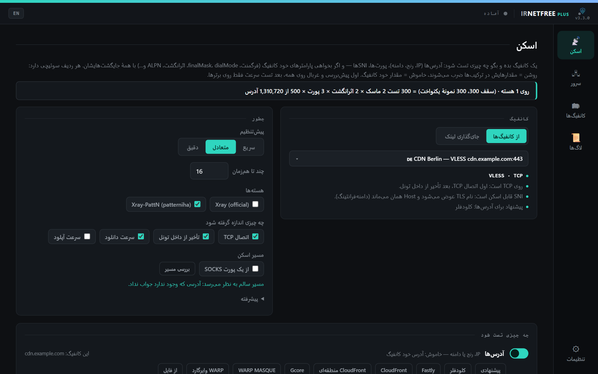
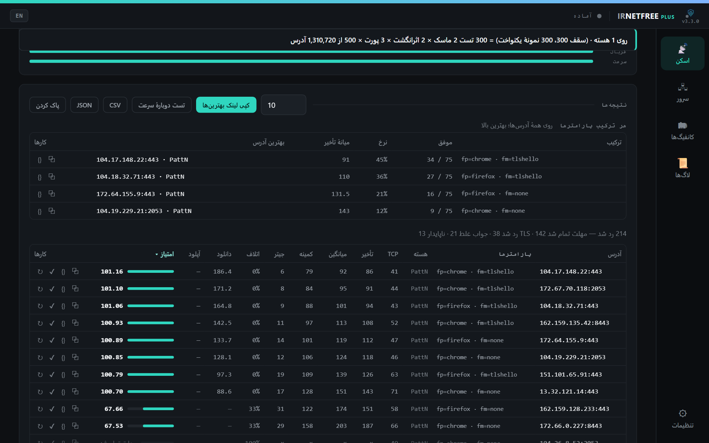
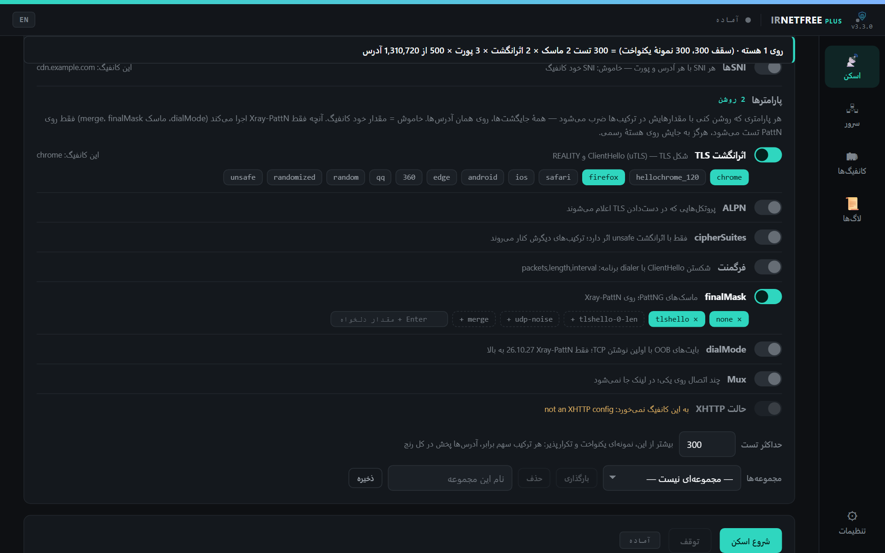
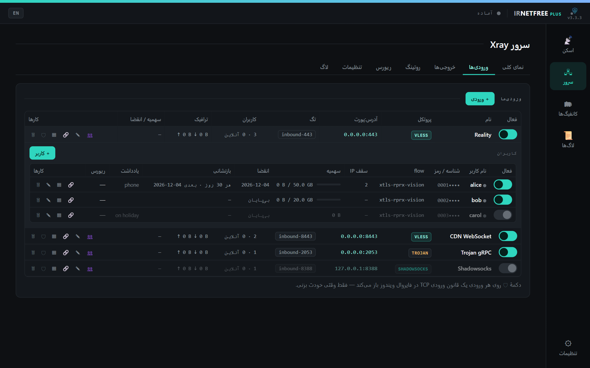
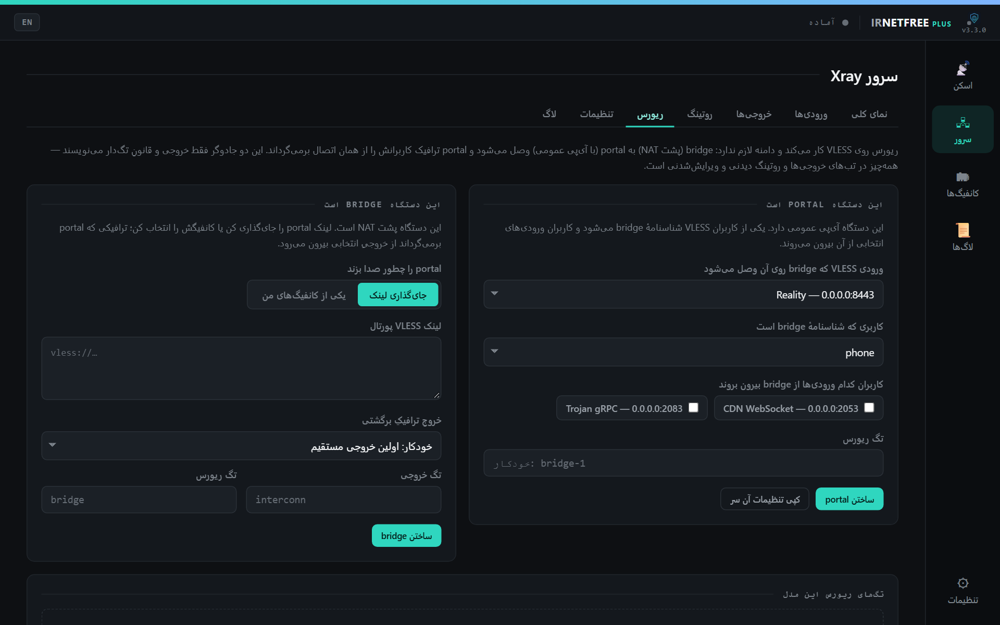
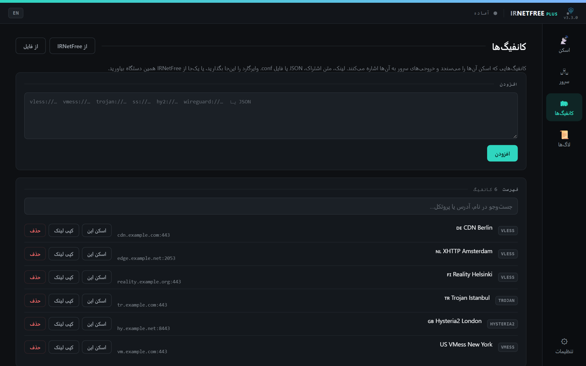
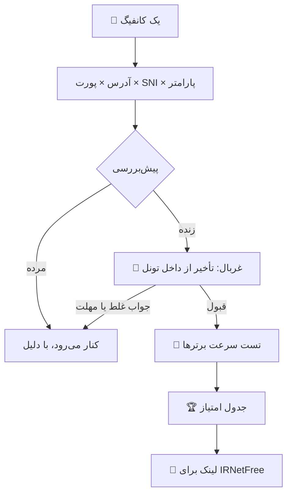

<div align="center">



<br>

[](https://github.com/sadrazkh/Irnetfree_xray-client-plus/releases/latest)
[](https://github.com/sadrazkh/Irnetfree_xray-client-plus/releases)
[](https://github.com/sadrazkh/Irnetfree_xray-client-plus/actions/workflows/test.yml)
[](https://github.com/sadrazkh/Irnetfree_xray-client-plus/stargazers)

**فارسی** · [English](README.en.md) · [📖 راهنمای کامل](GUIDE.md)

### جعبه‌ابزار کنار IRNetFree: آدرس تمیز پیدا کن، سرور خودت را بالا بیاور.

[](#-دانلود)
[](#-دانلود)
[](#-دانلود)
[](GUIDE.md#-بدون-صفحه‌نمایش-headless)

</div>

<div dir="rtl">

## 💎 چرا IRNetFree Plus؟

<table>
  <tr>
    <td width="50%">🎯 <b>هر رنجی، بدون سقف</b><br>رنج‌های Cloudflare، Fastly، CloudFront و Gcore آماده‌اند و با یک دکمه به‌روز می‌شوند. حتی یک ‎/8 با ۱۶ میلیون آدرس هم بدون مشکل اسکن می‌شود.</td>
    <td width="50%">🧬 <b>فقط IP نه، پارامتر هم</b><br>اثرانگشت TLS، ALPN، فرگمنت، finalMask، dialMode و Mux با همه‌ی جایگشت‌هایشان، روی همان آدرس‌ها تست می‌شوند.</td>
  </tr>
  <tr>
    <td>✅ <b>قبولی یعنی جواب درست</b><br>یک جواب شانسی یا صفحه‌ی خطا قبول نیست. هدف باید از داخل تونل جواب درست بگیرد، و هر ردیف ردشده دلیلش را می‌گوید.</td>
    <td>🚦 <b>مسیر را خودش می‌سنجد</b><br>اگر VPN به‌جای آدرس‌ها جواب بدهد، می‌گوید نتیجه واقعی نیست. می‌توانی اسکن را از یک پورت SOCKS رد کنی.</td>
  </tr>
  <tr>
    <td>🖧 <b>سرور Xray به سبک 3x-ui</b><br>ورودی، کاربر با سهمیه و انقضا، خروجی، روتینگ و ریورس‌پراکسی، بدون پنل وب و دیتابیس.</td>
    <td>🤝 <b>همراه IRNetFree</b><br>کانفیگ‌ها را یک‌جا از IRNetFree می‌آورد و بهترین نتیجه‌ها را به‌صورت لینک پس می‌دهد. هر دو برنامه با هم اجرا می‌شوند.</td>
  </tr>
</table>

## 📸 نگاهی به برنامه

<table>
  <tr>
    <td width="50%"><br><b>📡 اسکن:</b> کانفیگ، هسته‌ها، مسیر اسکن و رنج‌های آماده</td>
    <td width="50%"><br><b>🏆 نتیجه‌ها:</b> امتیاز هر آدرس، خلاصه‌ی هر ترکیب و کپی بهترین‌ها</td>
  </tr>
  <tr>
    <td><br><b>🧬 پارامترها:</b> هر ردیف یک سوئیچ، با مقدارهای آماده یا دلخواه</td>
    <td><br><b>🖧 سرور:</b> ورودی‌ها با Reality یا TLS و کاربرهای جدا</td>
  </tr>
  <tr>
    <td><br><b>🔁 ریورس:</b> دو جادوگر portal و bridge برای دستگاه پشت NAT</td>
    <td><br><b>🗂 کانفیگ‌ها:</b> لینک، فایل، یا یک‌جا از IRNetFree</td>
  </tr>
</table>

<sub>عکس‌ها از خود برنامه‌اند، با کانفیگ‌ها و عددهای ساختگی.</sub>

## 📥 دانلود

آخرین نسخه را از **[صفحه‌ی انتشارها](https://github.com/sadrazkh/Irnetfree_xray-client-plus/releases/latest)** بگیر. `x.y.z` شماره‌ی نسخه است.

| سیستم | فایل | نکته |
|---|---|---|
| 🪟 **ویندوز** | `IRNetFree-Plus-Setup-x.y.z.exe` | نصبی |
| | `IRNetFree-Plus-Portable-x.y.z.exe` | بدون نصب |
| 🍎 **مک، Apple Silicon** | `IRNetFree-Plus-x.y.z-arm64.dmg` | [اولین اجرا روی مک](GUIDE.md#-اولین-اجرا-روی-مک-macos-first-run) |
| 🍏 **مک، Intel** | `IRNetFree-Plus-x.y.z-x64.dmg` | همان راهنما |
| 🐧 **لینوکس** | `IRNetFree-Plus-x.y.z-amd64.deb` | دبیان و اوبونتو |
| | `IRNetFree-Plus-x.y.z-x86_64.AppImage` | بیشتر توزیع‌ها |

نسخه‌ی اندروید و روتر ندارد. برای این‌ها [خود IRNetFree](https://github.com/sadrazkh/Irnetfree_xray-client) را نصب کن.

<details>
<summary>🖥️ اجرا روی سرور بدون صفحه‌نمایش</summary>

<div dir="ltr">

```bash
git clone https://github.com/sadrazkh/Irnetfree_xray-client-plus.git
cd Irnetfree_xray-client-plus
node src/server/server.js --port 6970
```

</div>

همان صفحه‌ها روی یک پورت وب بالا می‌آیند و پیش‌فرض فقط روی `127.0.0.1` گوش می‌دهند، پس با SSH به آن‌ها وصل می‌شوی. [جزئیات](GUIDE.md#-بدون-صفحه‌نمایش-headless)

</details>

<details>
<summary>🧪 نسخه‌ی در حال توسعه</summary>

پیش‌انتشار [dev](https://github.com/sadrazkh/Irnetfree_xray-client-plus/releases/tag/dev) با هر تغییر کد روی `main` دوباره ساخته می‌شود، فقط برای ویندوز. برنامه این نسخه را به‌عنوان به‌روزرسانی پیشنهاد نمی‌کند.

</details>

## ⚡ شروع در یک دقیقه

1. برنامه را باز کن و از **«تنظیمات ← هسته‌ها»** هسته‌ی Xray را دریافت کن.
2. VPN را خاموش کن. VPN در حالت TUN به‌جای آدرس‌ها جواب می‌دهد و نتیجه را بی‌معنی می‌کند. دکمه‌ی **«بررسی مسیر»** وضعیت را می‌گوید.
3. لینک کانفیگ را در صفحه‌ی **«کانفیگ‌ها»** بگذار، یا **«از IRNetFree»** را بزن.
4. در صفحه‌ی **«اسکن»** کانفیگ و رنج را انتخاب کن، مثلاً **«کلودفلر»** و **«N تصادفی از همه»**، بعد **«شروع اسکن»** را بزن.
5. **«کپی لینک بهترین‌ها»** را بزن و لینک‌ها را در IRNetFree بچسبان ✅

> 💡 این برنامه کلاینت VPN نیست و خودش شما را به اینترنت وصل نمی‌کند. آنچه پیدا می‌شود را در IRNetFree یا هر کلاینت دیگری استفاده کن.

## ✨ امکانات

<details open>
<summary><b>📡 چه چیزی اسکن می‌شود</b></summary>

- **همه‌ی پروتکل‌ها:** VLESS، VMess، Trojan، Shadowsocks، Hysteria2، WireGuard، MASQUE، WARP روی MASQUE و کانفیگ JSON
- **آدرس‌ها:** IPv4، IPv6، رنج CIDR و `a-b` و دامنه، هر کدام با پورت خودش در صورت نیاز
- **رنج‌های آماده:** Cloudflare، Fastly، CloudFront، CloudFront منطقه‌ای، Gcore، WARP MASQUE و WARP وایرگارد، به‌علاوه‌ی دکمه‌ی **«پیشنهادی»** که از روی کانفیگ انتخاب می‌کند
- **به‌روزرسانی لیست‌ها:** فهرست رسمی هر CDN را با یک دکمه از خودش می‌گیرد
- **پورت و SNI:** هر پورت و هر SNI با هر آدرس ترکیب می‌شود

</details>

<details>
<summary><b>🎲 چند آدرس از هر رنج</b></summary>

- **همه‌ی آدرس‌ها:** بدون سقف؛ آدرس‌ها دسته‌دسته تست می‌شوند و رنج هیچ‌وقت در حافظه فهرست نمی‌شود
- **N تصادفی از همه:** نمونه‌ی یکنواخت از همه‌ی رنج‌ها با هم
- **N از هر رنج:** سهم برابر برای هر خط
- **N از هر بلوک:** مثلاً از هر ۲۵۶ آدرس چند تا، پس یک ‎/22 چهار برابر یک ‎/24 سهم می‌گیرد
- تاریخچه‌ی آدرس‌های تست‌شده روی همین دستگاه می‌ماند تا اجرای بعد سراغ آدرس تازه برود

</details>

<details>
<summary><b>🧬 پارامترهای کانفیگ</b></summary>

- اثرانگشت TLS، ALPN، cipherSuites، فرگمنت، finalMask، dialMode، Mux و حالت XHTTP
- هر ردیف سوئیچ دارد: روشن یعنی مقدارهایش در ترکیب‌ها ضرب می‌شوند، خاموش یعنی مقدار خود کانفیگ
- پارامتری که به کانفیگ نمی‌خورد، دلیلش را می‌گوید
- آنچه فقط Xray-PattN اجرا می‌کند، فقط روی همان هسته تست می‌شود
- بیشتر از «حداکثر تست» نمونه‌ی یکنواخت و تکرارپذیر می‌گیرد، و مجموعه‌ی پارامترها را با نام ذخیره می‌کند

</details>

<details>
<summary><b>🎯 دقت نتیجه</b></summary>

- **دو مرحله:** اول غربال سریع روی همه، بعد تست سرعت فقط روی برترها
- **قبولی:** پیش‌فرض، دست‌کم دو نمونه از سه جواب درست از داخل تونل
- **پیش‌بررسی:** آدرس مرده با یک اتصال TCP یا TLS کنار می‌رود و هسته‌ای برایش بالا نمی‌آید
- **امتیاز:** اول درصد موفقیت، بعد میانه‌ی تأخیر، بعد جیتر
- **دلیل رد:** بدون TCP، TLS، هسته، پروکسی رد کرد، تونل بسته شد، مهلت، جواب غلط یا ناپایدار
- کانفیگ‌های UDP تست TCP بی‌معنی نمی‌گیرند و هسته‌ی قدیمی با دلیلش کنار می‌رود

</details>

<details>
<summary><b>🚦 مسیر اسکن و پورت SOCKS</b></summary>

- **بررسی مسیر:** آدرسی که وجود ندارد نباید جواب بدهد؛ اگر جواب داد، برنامه هشدار می‌دهد
- **اسکن از یک پورت SOCKS:** مثلاً پورت مستقیم IRNetFree تا VPN روشن بماند و اسکن از خط واقعی برود
- محدودیت‌های این حالت در [راهنما](GUIDE.md#-مسیر-اسکن-و-vpn-scan-path) آمده است

</details>

<details>
<summary><b>📤 بعد از اسکن</b></summary>

- کپی لینک یا JSON هر ردیف، با همان آدرس و همان پارامترها
- **کپی لینک بهترین‌ها** برای وارد کردن در IRNetFree
- ذخیره در کانفیگ‌ها و تست دوباره‌ی سرعت
- خلاصه‌ی هر ترکیب: چند بار قبول، نرخ، میانه‌ی تأخیر و بهترین آدرس
- خروجی CSV و JSON

</details>

<details>
<summary><b>🖧 سرور Xray</b></summary>

- هفت بخش به سبک 3x-ui: نمای کلی، ورودی‌ها، خروجی‌ها، روتینگ، ریورس، تنظیمات و لاگ
- **ورودی‌ها:** VLESS، VMess، Trojan و Shadowsocks روی TCP، WebSocket، gRPC و XHTTP، با none، TLS یا Reality
- **کاربرها:** سهمیه، انقضا، چرخه‌ی ریست، لینک و QR، و غیرفعال شدن خودکار
- **خروجی‌ها:** مستقیم، مسدود، از کانفیگ‌های خودت یا از یک لینک
- **ریورس‌پراکسی:** دو جادوگر portal و bridge برای دستگاه پشت NAT
- سرور با بستن پنجره در سینی سیستم روشن می‌ماند

</details>

## 🗺️ اسکن چطور کار می‌کند؟

<div dir="ltr">



</div>

## 📖 راهنمای کامل

همه‌ی جزئیات در **[GUIDE.md](GUIDE.md)** است:

| شروع | اسکن | سرور | بیشتر |
|---|---|---|---|
| [نصب و اجرا](GUIDE.md#-نصب-و-اجرا-setup) | [چه چیزی اسکن می‌شود](GUIDE.md#-اسکن-scan) | [ورودی و کاربر](GUIDE.md#-سرور-server) | [حریم خصوصی و شبکه](GUIDE.md#-حریم-خصوصی-و-شبکه-privacy) |
| [اولین اجرا روی مک](GUIDE.md#-اولین-اجرا-روی-مک-macos-first-run) | [مسیر اسکن و VPN](GUIDE.md#-مسیر-اسکن-و-vpn-scan-path) | [کانفیگ‌ها](GUIDE.md#-کانفیگ‌ها-configs) | [توسعه و هم‌گام‌سازی](GUIDE.md#-توسعه-development) |
| [بدون صفحه‌نمایش](GUIDE.md#-بدون-صفحه‌نمایش-headless) | | | [تغییرات هر نسخه](https://github.com/sadrazkh/Irnetfree_xray-client-plus/releases) |

## ❓ پرسش‌های پرتکرار

<details>
<summary><b>پلاس جای IRNetFree را می‌گیرد؟</b></summary>

نه. پلاس کلاینت نیست و خودش وصل نمی‌کند. کار پلاس پیدا کردن آدرس و پارامتر خوب و راه‌انداختن سرور است، و کار IRNetFree وصل کردن.

</details>

<details>
<summary><b>چرا باید موقع اسکن VPN خاموش باشد؟</b></summary>

چون VPN در حالت TUN به‌جای آدرس‌ها جواب می‌دهد و همه‌چیز زنده به نظر می‌رسد. یا VPN را خاموش کن، یا در IRNetFree یک پورت مستقیم باز کن و اسکن را از آن رد کن. [جزئیات](GUIDE.md#-مسیر-اسکن-و-vpn-scan-path)

</details>

<details>
<summary><b>آدرسی که پیدا شد برای هر کانفیگی خوب است؟</b></summary>

نتیجه فقط برای همان کانفیگی است که اسکن کردی. برای کانفیگ دیگر دوباره اسکن کن.

</details>

<details>
<summary><b>پلاس دسترسی ادمین می‌خواهد؟</b></summary>

نه. با کاربر عادی اجرا می‌شود. فقط دکمه‌ی فایروال در تب سرور ویندوز، برای همان یک دستور UAC می‌پرسد.

</details>

<details>
<summary><b>مک برنامه را باز نمی‌کند.</b></summary>

راه‌حلش در [اولین اجرا روی مک](GUIDE.md#-اولین-اجرا-روی-مک-macos-first-run) آمده است.

</details>

<details>
<summary><b>کانفیگ‌ها و نتیجه‌هایم کجا می‌روند؟</b></summary>

روی همان دستگاه می‌مانند. فهرست کامل چیزهایی که برنامه به آن‌ها وصل می‌شود در [این بخش](GUIDE.md#-حریم-خصوصی-و-شبکه-privacy) آمده است.

</details>

## 🛠️ ساخت از سورس

<div dir="ltr">

```bash
git clone https://github.com/sadrazkh/Irnetfree_xray-client-plus.git
cd Irnetfree_xray-client-plus
npm install
npm run get-xray
npm start
```

</div>

برای `npm test` به Node.js نسخه‌ی ۲۱ یا بالاتر نیاز داری. [بقیه‌ی دستورها و هم‌گام‌سازی با IRNetFree](GUIDE.md#-توسعه-development)

## 🙏 ساخته شده با

[IRNetFree](https://github.com/sadrazkh/Irnetfree_xray-client) · [Xray-core](https://github.com/XTLS/Xray-core) · [Xray-PattN](https://github.com/patterniha/Xray-core) · [Electron](https://www.electronjs.org/)

تب سرور با الهام از مدل [3x-ui](https://github.com/MHSanaei/3x-ui) ساخته شده است. مجوز: MIT

</div>

<div align="center">

<br>

**اگر به کارت آمد، یک ⭐ بده تا بقیه هم پیدایش کنند.**

[🐞 گزارش مشکل](https://github.com/sadrazkh/Irnetfree_xray-client-plus/issues) · [🧾 انتشارها](https://github.com/sadrazkh/Irnetfree_xray-client-plus/releases)

</div>
