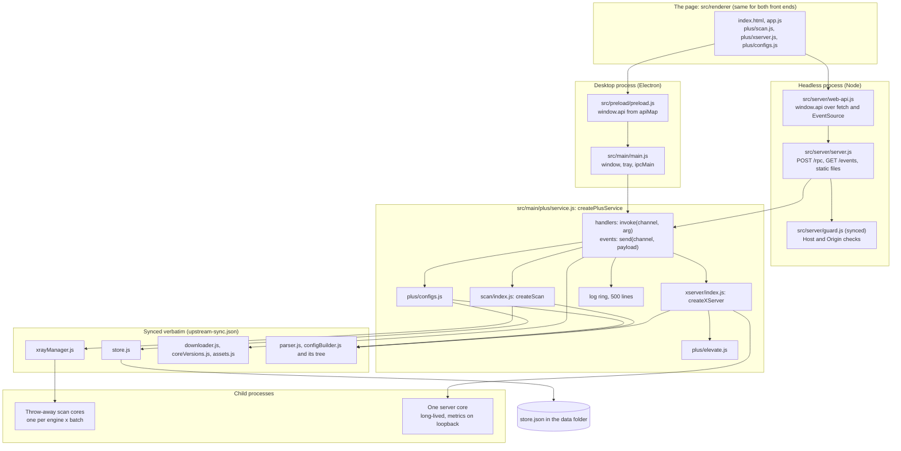
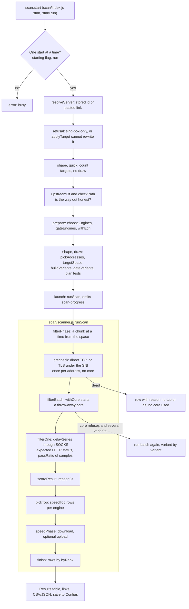
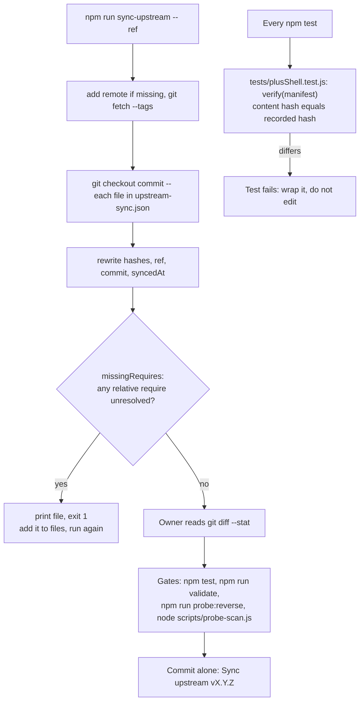
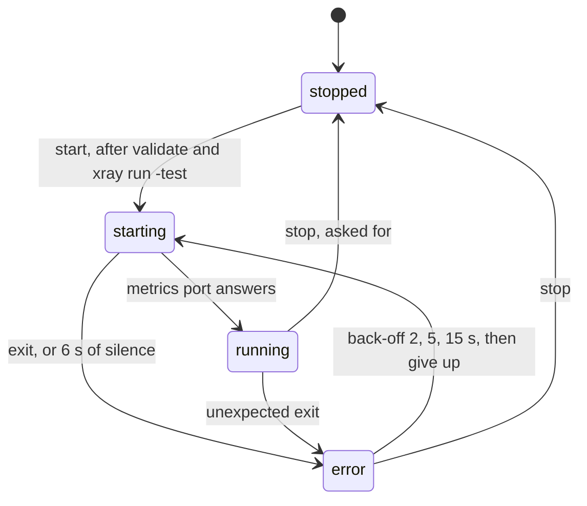

Last verified: 2026-11-08
Scope checked: `src/main/main.js`, `src/main/plus/*`, `src/main/scan/*`, `src/main/xserver/*`, `src/server/*`, `src/preload/preload.js`, `src/renderer/app.js`, `src/renderer/index.html`, `scripts/sync-upstream.js`, `upstream-sync.json`, all `require()` edges from own code to synced code. Labels: V / A / R, see `MASTER_CONTEXT.md`.

# Architecture

## Process and component map

| Fact | Status |
|---|---|
| `window.api` is built from one data map by both bridges, so the front ends cannot offer different methods | V: `src/main/plus/apiMap.js` `INVOKE`, `EVENTS`, `WINDOW`; `src/preload/preload.js`; `src/server/web-api.js`; `tests/plusShell.test.js` |
| The service is one module, with no mirror per front end | V: `src/main/plus/service.js` header; called from `main.js` and `server.js` |
| A tool registers its own channels through `ctx.handle` | V: `service.js` `ctx`; `createScan(...).register`; `createXServer(...).register` |
| The Electron shell adds only `win:*`, `app:openExternal`, `app:openDataDir`. The headless server adds only `app:quit` | V: `main.js` `registerIpc`; `server.js` `handle` |
| The renderer never writes the server model; every edit goes through `xserver:set` | V: `src/renderer/plus/xserver.js` header; `xserver/index.js` |

## The code split

`upstream-sync.json` is the authority. Path by path (V: manifest against `git ls-files`; the 41 synced files are grouped by purpose in [SYNC.md](SYNC.md)):

| Path | Kind |
|---|---|
| `src/main/main.js` | **Own** |
| every other `src/main/*.js` (25 files) | Synced, do not edit |
| `src/main/plus/`, `src/main/scan/`, `src/main/xserver/` | **Own** |
| `src/modules/lanUsers/` (2) | Synced, do not edit |
| `src/preload/preload.js` | **Own** |
| `src/server/server.js`, `src/server/web-api.js` | **Own** |
| `src/server/guard.js` | Synced, do not edit |
| `src/renderer/index.html`, `src/renderer/app.js`, `src/renderer/plus/` | **Own** |
| every other file in `src/renderer/` and `src/renderer/vendor/` (11) | Synced, do not edit |
| `scripts/validate-configs.js`, `probe-reverse.js`, `probe-scan.js`, `sync-upstream.js`, `update-cdn-ranges.js` | **Own** |
| `scripts/download-xray.js`, `scripts/gen-icons.js` | Synced, do not edit |
| `tests/`, `.github/`, `assets/`, `package.json`, docs | **Own** |

Own code calls synced code. Synced code never calls own code. V: every relative `require()` in the files below, and `missingRequires` in `scripts/sync-upstream.js` for closure.

| Own module | Synced modules it uses |
|---|---|
| `plus/service.js` | `store`, `xrayManager`, `downloader`, `coreVersions`, `assets`, `engines` |
| `plus/configs.js` | `parser` |
| `scan/index.js` | `parser`, `configBuilder`, `xrayManager`, `engineChoice`, `engines` |
| `scan/scanner.js` | `configBuilder`, `xrayManager`, `netutils` |
| `scan/substitute.js` | `jsonImport`, `src/renderer/serverFields` |
| `scan/variants.js` | `mux`, `xrayManager`, `src/renderer/serverFields` |
| `scan/probes.js` | `netutils` |
| `scan/ech.js` | `configBuilder` |
| `xserver/config.js` | `parser`, `configBuilder` |
| `xserver/core.js` | `engines`, `xrayManager` |
| `xserver/index.js` | `engines` |
| `src/server/server.js` | `src/server/guard` |

Synced but required only by other synced files, so Plus calls none of it directly: `groups`, `addressSwap`, `targetOutbounds`, `tunAppTargets`, `tunApps`, `multiWan`, `capPeriods`, `jalali`, `src/modules/lanUsers/*`, `src/renderer/modules.js`, `assetUpdater`, `routingProfiles`, `certPin`, `dnsBuilder`. `coreCompat` is reached through `xrayManager` and directly by `scripts/validate-configs.js`. V: `docs/SYNC.md` plus a grep of `require()` edges.

Page-level wrapping: upstream `i18n.js` loads first and `plus/i18n.js` wraps it, asking Plus's own dictionaries first. V: `src/renderer/plus/i18n.js`; load order pinned by `tests/renderer.test.js`.

## Scan pipeline

| Fact | Status |
|---|---|
| A target range is a lazy space (`{ size, at(i) }`); no address list of a `/8` is ever built | V: `scan/targets.js` `addressSpace`, `targetSpace`; `scan/scanner.js` `sourceOf`, `chunkOf` |
| Concurrency has three separate limits: pre-check, delay probes (across all cores), cores in parallel. Speed has a fourth | V: `scanner.js` `makeContext` `preLimit`, `probeLimit`, `coreLimit`, `speedLimit` |
| A core is probed only once its first inbound accepts a connection (100 ms steps, up to 4 s) | V: `scanner.js` `waitListening`, `withCore`, `SCAN_DEFAULTS.readyTimeout` |
| Runs over 20,000 rows send only passing rows and count the dead by reason | V: `scan/index.js` `STREAM_ALL`, `launch` |
| Stop is a flag read before every chunk, batch, target and round; a poll kills a live core | V: `scanner.js` header, `withCore` `CANCEL_POLL_MS` |

## Upstream sync

V: `scripts/sync-upstream.js` `sync`, `verify`, `missingRequires`, `hashOf`; `docs/SYNC.md`. Hashes normalise CRLF to LF. A sync can break own code silently only where tests do not reach: names the scanner reads from synced files are pinned by `tests/scanVariants.test.js` and `tests/scan.service.test.js`. V: `docs/SYNC.md`.

## Server tab runtime

V: `src/main/xserver/core.js` `ServerCore` `_start`, `_onExit`, `CRASH_BACKOFF_MS`, `POLL_MS`, `POLL_TRIES`. A running core is read every 5 s (`TICK_MS`); a client who runs out changes the config's client list, so the core restarts after a 10 s debounce (`RESTART_DEBOUNCE_MS`). V: `_tick`, `_enforce`, `_scheduleRestart`.

## Trust boundaries

| Boundary | Control | Status |
|---|---|---|
| Page to main (desktop) | `contextIsolation: true`, `nodeIntegration: false`, `sandbox: false`, navigation limited to the app page | V: `main.js` `createWindow` |
| Page content | CSP `script-src 'self'`, `connect-src 'self'`, no remote code | V: `index.html` meta tag |
| Browser to headless server | Loopback by default; token on any other bind; Host and Origin guards | V: `server.js`, `guard.js` |
| Elevation | One `netsh`, only after Windows says it is needed | V: `plus/elevate.js`, `xserver/index.js` `xserver:firewall` |
| Tests to machine | `child_process` wrappers refuse system commands | V: `tests/noNetwork.preload.js` `BLOCKED` |

Gaps at these boundaries are logged in `KNOWN_ISSUES_AND_TECH_DEBT.md` (KI-03, KI-04, KI-05).
